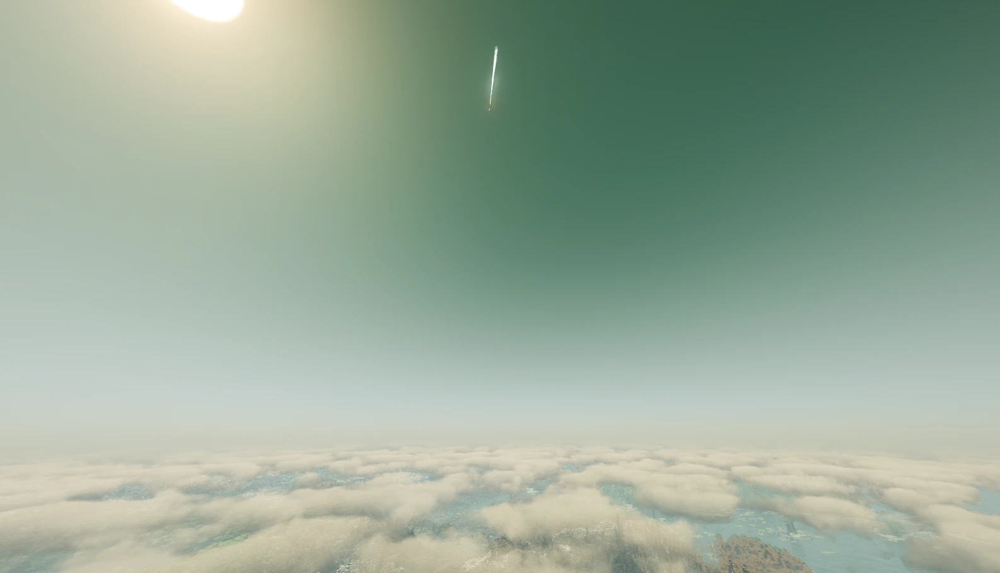

# NTM × Distant Horizons Compat (Fabric и NeoForge 26.2)

> **Устарел.** Начиная с NTM-NEXT 1.0.3 (вместе с Crankshaft 1.6.0) всё основное NTM делает сам: дальний трекинг
> и отрисовку грибов и ракет (`FarVisible`, настройка `farTrackingRange`), глубину LOD и высоту гриба над LOD.
> Этот мод нужен только для NTM 1.0.2 и с NTM 1.0.3+ не загружается. Аддонам со своими дальними сущностями
> достаточно реализовать `com.hbm.entity.FarVisible`.
Делает ядерные грибы, облака взрывов, крупные взрывы и полёт ракет NTM-NEXT видимыми на дальности Distant Horizons.



Ставить на **сервер и клиент** (в одиночной игре — просто в `mods`). Требует `hbm`, DH рекомендуется.

Два jar в каждом релизе: `ntm-dh-compat-fabric-*.jar` для Fabric и `ntm-dh-compat-neoforge-*.jar` для NeoForge.

## Что делает

| Где | Mixin | Зачем |
|---|---|---|
| сервер | `TrackedEntityMixin` | ваниль шлёт сущности только в пределах view distance и загруженных чанков игрока — для грибов/ракет лимит снят до `range` |
| сервер | `TargetPointMixin` | пакеты эффектов взрывов NTM (радиус ≥ `minEffectRadius`) рассылаются на `range` |
| клиент | `CameraMixin` | дальняя плоскость отсечения (4× прорисовки) отодвинута до `range × 1.25`, иначе всё дальше обрезается и отсекается фрустумом (сущности, частицы, Flywheel) |
| клиент | `LevelExtractorMixin` | ваниль рисует сущности только в скомпилированных секциях чанков |
| клиент | `ClientLevelMixin` | сущности в незагруженных клиентом чанках не тикают — гриб застыл бы, ракета висела бы |
| клиент | `NukeTorexMixin` | в незагруженном чанке heightmap = дно мира, ножка гриба уезжала бы вниз; берётся высота детонации |
| сервер | `NukeTorexMixin` | гриб не сохраняется и не держит чанк: улетишь — сервер перестаёт его отслеживать, при возврате анимация шла заново. Пока гриб жив, его чанк держится тикетом |
| сервер | `NukeExplosionMixin`, `FalloutRainMixin` + `CraterLod` | DH перечитывает чанк только при сохранении на диск, и воронка на горизонте висела нетронутой до автосейва. Через 5 с после конца взрыва и fallout'а загруженные чанки в радиусе отдаются DH через `overwriteChunkDataAsync` |
| клиент | `MissileContrailMixin` | выхлоп NTM аддитивный и гаснет за ~3 с. Ракета оставляет крупный дымный инверсионный след, видимый на дальности LOD |
| клиент | `LodDepth` (DH API) | DH пишет глубину LOD в свою текстуру, поэтому гриб/ракеты/частицы рисовались поверх LOD-рельефа. После рендера DH его глубина перепроецируется в ванильный буфер глубины (оба движка DH: OPEN_GL и BLAZE_3D) |
| клиент, NeoForge | `DhFadeMixin` | на NeoForge DH рисует проходы перехода «ваниль → LOD» после сущностей и частиц и затирал ими гриб; там они отключены |

## Конфиг `config/ntm_dh_compat.properties`

- `range=4096` — блоки; ставь примерно равным дальности LOD в DH.
- `minEffectRadius=150` — с какого радиуса пакет эффекта считается взрывом.
- `entities=...` — regex по id сущностей `hbm:*`. Все сущности [NTM Air Defense](https://github.com/DmitryKalibrov/NTM-NEXT-Air-Defense) (зенитные ракеты, мишени) видны издалека всегда.
- `contrailSeconds=30` — сколько живёт инверсионный след ракеты; `0` выключает.
- `lodDepth=true` — перенос глубины LOD (выключи, если появятся артефакты на границе ванильных чанков и LOD).

## Сборка

```
gradlew build
```
Нужен JDK 25. Общий код в `common/`, обвязки загрузчиков в `fabric/` и `neoforge/`.
Jar: `fabric/build/libs/` и `neoforge/build/libs/`. Если Maven Central недоступен: `gradlew -I tools/mirror.init.gradle.kts build`.
